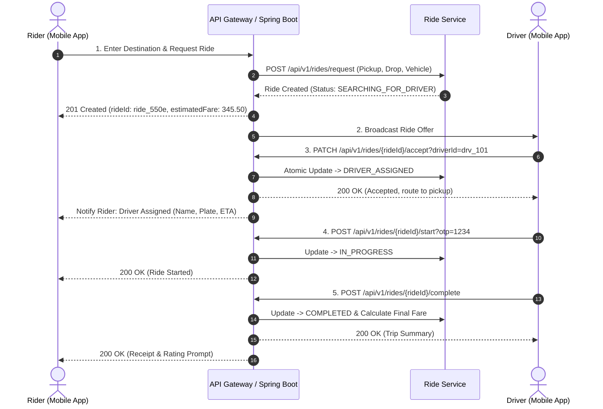

# 🚗 Ride-Sharing & Driver Dispatch Platform

[](https://www.oracle.com/java/)
[](https://spring.io/projects/spring-boot)
[](#round-2--low-level-design-challenge)
[](LICENSE)

An end-to-end, enterprise-grade system design and implementation of a scalable **Ride-Sharing & Driver Dispatch Platform** (similar to Uber/Grab/Lyft), divided into **Round 2 (Low-Level Design Challenge)** and **Round 3 (High-Level System Design Challenge)**.

---

## 📁 Repository Structure

```tree
SD-SAT1/
├── README.md                          # Master GitHub overview & quickstart guide
├── round-2-lld/                       # ROUND 2: Low-Level Design Challenge (30 Marks)
│   ├── README.md                      # REST API specs, payloads, status codes, sequence diagrams
│   ├── pom.xml                        # Maven configuration for Spring Boot
│   └── src/
│       ├── main/
│       │   ├── java/com/ridesharing/
│       │   │   ├── RideSharingApplication.java      # Application entry point
│       │   │   ├── controller/                      # REST API Controllers (Request, Nearby, Accept, Cancel)
│       │   │   │   ├── RideController.java
│       │   │   │   └── DriverController.java
│       │   │   ├── dto/                             # Data Transfer Objects with validation annotations
│       │   │   │   ├── ApiResponse.java
│       │   │   │   ├── RequestRideDto.java
│       │   │   │   ├── RideResponseDto.java
│       │   │   │   ├── DriverDto.java
│       │   │   │   ├── LocationDto.java
│       │   │   │   └── CancelRideDto.java
│       │   │   ├── model/                           # Domain Entities & Lifecycle Enums
│       │   │   │   ├── Ride.java
│       │   │   │   ├── RideStatus.java
│       │   │   │   ├── Driver.java
│       │   │   │   ├── DriverStatus.java
│       │   │   │   └── Location.java (Haversine formula)
│       │   │   ├── service/                         # Business Logic & State Machine Services
│       │   │   │   ├── RideService.java
│       │   │   │   └── DriverService.java
│       │   │   ├── repository/                      # Thread-Safe In-Memory Repositories
│       │   │   │   ├── InMemoryRideRepository.java
│       │   │   │   └── InMemoryDriverRepository.java
│       │   │   └── exception/                       # Custom Exceptions & Global Exception Handler
│       │   │       ├── GlobalExceptionHandler.java
│       │   │       ├── ResourceNotFoundException.java
│       │   │       ├── InvalidRideStateException.java
│       │   │       └── NoDriversAvailableException.java
│       │   └── resources/
│       │       └── application.properties
│       └── test/java/com/ridesharing/service/
│           └── RideServiceTest.java                 # Complete automated test suite
└── round-3-hld/                       # ROUND 3: High-Level System Design Challenge (25 Marks)
    ├── README.md                      # High-Level Architecture, DB selection, Caching, Kafka, Scalability
    └── src/main/java/com/ridesharing/hld/
        ├── messaging/                 # Kafka Event Schemas & Publisher/Consumer classes
        │   ├── RideRequestedEvent.java
        │   ├── DriverAssignedEvent.java
        │   ├── RideEventKafkaPublisher.java
        │   └── RideEventKafkaConsumer.java
        ├── cache/                     # Redis Geospatial & TTL In-Memory cache implementation
        │   └── GeoLocationCacheService.java
        └── scalability/               # Token Bucket Rate Limiting for surge spikes
            └── TokenBucketRateLimiter.java
```

---

## 📌 Round 2 – Low-Level Design (LLD) Summary

### 1. REST APIs & URIs

| Action | HTTP Method | Endpoint URI | Description |
|---|---|---|---|
| **Get Nearby Drivers** | `GET` | `/api/v1/drivers/nearby?latitude=...&longitude=...&radiusKm=5.0` | Spatial query for active drivers |
| **Request Ride** | `POST` | `/api/v1/rides/request` | Create ride & initiate dispatch |
| **Accept Ride** | `PATCH` | `/api/v1/rides/{rideId}/accept?driverId={driverId}` | Driver accepts ride assignment |
| **Get Ride Status** | `GET` | `/api/v1/rides/{rideId}/status` | Polling/fetching live ride progress |
| **Cancel Ride** | `POST` | `/api/v1/rides/{rideId}/cancel` | Rider/driver cancels ride with reason |

### 2. Request Ride Payload Sample
```json
POST /api/v1/rides/request
Content-Type: application/json

{
  "riderId": "usr_98a7c210",
  "vehicleType": "SEDAN",
  "pickupLocation": {
    "address": "Airport Terminal 2, Mumbai",
    "latitude": 19.0896,
    "longitude": 72.8656
  },
  "dropLocation": {
    "address": "Bandra Kurla Complex (BKC), Mumbai",
    "latitude": 19.0660,
    "longitude": 72.8677
  },
  "paymentMethod": "CARD"
}
```

### 3. HTTP Status Codes Handled
- `200 OK`: Successful retrieval/updates.
- `201 Created`: Ride created successfully.
- `400 Bad Request`: Payload validation failures (missing lat/long, invalid coordinates).
- `404 Not Found`: Ride or driver ID does not exist.
- `409 Conflict`: Ride already accepted by another driver or invalid state transition.
- `422 Unprocessable Entity`: No drivers available in radius or zero distance.
- `500 Internal Server Error`: Unhandled backend errors.

### 4. End-to-End Sequence Diagram



---

## 📌 Round 3 – High-Level System Design (HLD) Summary

### 1. Microservices Architecture
- **User Service:** Rider authentication, profiles, saved cards.
- **Driver Service:** Driver onboarding, documents, vehicle verification.
- **Ride & Dispatch Service:** Core state machine, matching engine.
- **Location Tracking Service:** Real-time GPS ingestion (every 3s) using Uber H3 / Geohash.
- **Pricing & Surge Engine:** Real-time dynamic pricing based on local supply vs. demand.
- **Payment Service:** Transaction processing with idempotency keys and ledger logging.
- **Notification Service:** Out-of-band alerts (Apple APNs / Google FCM / SMS).

### 2. Database Selection
- **Users, Drivers, Payments:** **PostgreSQL** (Multi-AZ, ACID guarantees, strict consistency).
- **Rides History & Telemetry:** **Apache Cassandra / ScyllaDB** (Massive write throughput, linear horizontal scalability).
- **Driver Locations & Spatial Index:** **Redis Geospatial Cluster** (`GEOADD`, `GEOSEARCH` in-memory).

### 3. Caching Strategy
- **Driver Availability:** In-memory Redis spatial index with **15-second TTL** on driver GPS heartbeats.
- **Popular Locations / POIs:** In-memory LRU Cache (Airports, Railway Stations, Malls).
- **Active Ride Sessions:** Redis Key-Value (`ride:{rideId}`) with 2-hour TTL.

### 4. Messaging & Event Bus (Apache Kafka)
- Topics: `ride.requested`, `driver.dispatched`, `ride.status_updated`, `payment.completed`.
- Partition key: `geohash_prefix` ensures strict regional ordering within city partitions.

### 5. Scalability & Sudden Traffic Spikes
- **Surge Pricing:** Automatic surge multiplier dampens excessive demand and incentivizes idle drivers.
- **Rate Limiting:** Token Bucket algorithm implemented at API Gateway (Kong/Envoy).
- **Queue-Based Load Leveling:** Kafka buffers incoming ride requests, eliminating database spikes.
- **Horizontal Pod Autoscaling (HPA):** Auto-scales Kubernetes worker pods based on Kafka consumer lag.

---

## 🚀 How to Run the Java Project Locally

### Prerequisites
- Java 17+
- Apache Maven 3.8+

### Steps:
```bash
# 1. Navigate to Round 2 LLD directory
cd round-2-lld

# 2. Run automated tests
mvn clean test

# 3. Start the Spring Boot REST API server
mvn spring-boot:run
```

Once started, the server listens at: `http://localhost:8080/api/v1`

---

## 🧪 Testing the APIs with cURL

### 1. Get Nearby Drivers
```bash
curl -X GET "http://localhost:8080/api/v1/drivers/nearby?latitude=19.0896&longitude=72.8656&radiusKm=5.0"
```

### 2. Request a Ride (HTTP 201 Created)
```bash
curl -X POST "http://localhost:8080/api/v1/rides/request" \
  -H "Content-Type: application/json" \
  -d '{
    "riderId": "usr_98a7c210",
    "vehicleType": "SEDAN",
    "pickupLocation": {
      "address": "Airport Terminal 2, Mumbai",
      "latitude": 19.0896,
      "longitude": 72.8656
    },
    "dropLocation": {
      "address": "Bandra Kurla Complex, Mumbai",
      "latitude": 19.0660,
      "longitude": 72.8677
    },
    "paymentMethod": "CARD"
  }'
```

### 3. Accept a Ride
```bash
curl -X PATCH "http://localhost:8080/api/v1/rides/<RIDE_ID>/accept?driverId=drv_101"
```

### 4. Get Ride Status
```bash
curl -X GET "http://localhost:8080/api/v1/rides/<RIDE_ID>/status"
```

### 5. Cancel a Ride
```bash
curl -X POST "http://localhost:8080/api/v1/rides/<RIDE_ID>/cancel" \
  -H "Content-Type: application/json" \
  -d '{
    "cancelledBy": "RIDER",
    "cancellationReason": "PLAN_CHANGED",
    "notes": "Will take a ride later"
  }'
```

---

## 📤 Pushing to GitHub

To push this entire project to your GitHub repository:

```bash
git init
git add .
git commit -m "feat: complete Round 2 LLD and Round 3 HLD implementation for Ride-Sharing Platform"
git branch -M main
git remote add origin https://github.com/<your-username>/<your-repo-name>.git
git push -u origin main
```
