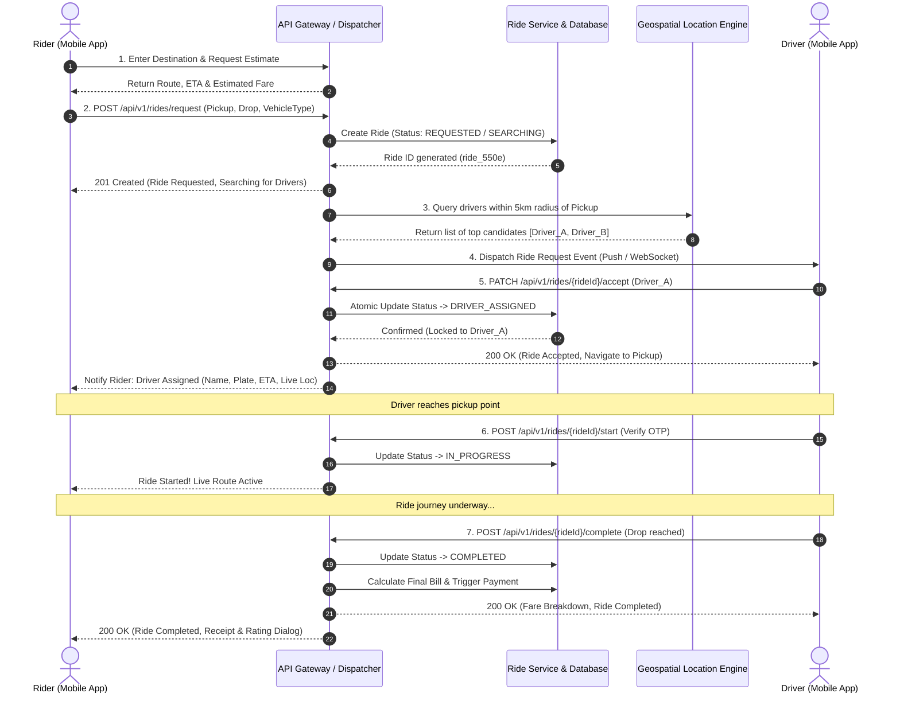

# Round 2: Low-Level Design Challenge (LLD) - Ride-Sharing & Driver Dispatch Platform

## Overview
This document contains the complete Low-Level Design (LLD) and REST API specifications for the Ride-Sharing & Driver Dispatch Platform. It covers all 6 tasks: API design, HTTP methods/URIs, request/response payloads, status code specifications, end-to-end sequence diagrams, and ride cancellation mechanics.

---

## Task 1 & 2: REST API Specifications (Method & URI)

| # | Action | HTTP Method | Endpoint URI | Description |
|---|--------|-------------|--------------|-------------|
| 1 | **Get Nearby Drivers** | `GET` | `/api/v1/drivers/nearby` | Queries available drivers within a specified geographic radius of the rider's coordinates. |
| 2 | **Request Ride** | `POST` | `/api/v1/rides/request` | Creates a new ride booking request and initiates driver dispatch matching. |
| 3 | **Accept Ride** | `PATCH` | `/api/v1/rides/{rideId}/accept` | Driver accepts an incoming ride assignment request. |
| 4 | **Get Ride Status** | `GET` | `/api/v1/rides/{rideId}/status` | Rider or driver fetches real-time lifecycle status and driver location tracking. |
| 5 | **Cancel Ride** | `POST` | `/api/v1/rides/{rideId}/cancel` | Allows rider or driver to cancel an active/pending ride with a mandatory reason code. |

---

## Task 3: Request & Response Design for "Request Ride" API

### Endpoint: `POST /api/v1/rides/request`
- **Headers:**
  - `Content-Type: application/json`
  - `Authorization: Bearer <jwt_access_token>`
  - `X-Idempotency-Key: <uuid-v4>` *(prevents duplicate ride requests on network retry)*

### Request Body (JSON)
```json
{
  "riderId": "usr_98a7c210",
  "vehicleType": "SEDAN_PREMIUM",
  "pickupLocation": {
    "address": "Terminal 2, Chhatrapati Shivaji Maharaj International Airport, Mumbai",
    "latitude": 19.0896,
    "longitude": 72.8656
  },
  "dropLocation": {
    "address": "Bandra Kurla Complex (BKC), Mumbai",
    "latitude": 19.0660,
    "longitude": 72.8677
  },
  "paymentMethod": "SAVED_CARD_VISA_4242"
}
```

### Successful Response (HTTP 201 Created)
```json
{
  "success": true,
  "statusCode": 201,
  "message": "Ride requested successfully. Searching for nearby drivers.",
  "data": {
    "rideId": "ride_550e8400",
    "status": "SEARCHING_FOR_DRIVER",
    "createdAt": "2026-10-12T09:30:00Z",
    "estimatedFare": {
      "currency": "INR",
      "baseFare": 150.00,
      "distanceKm": 9.4,
      "surgeMultiplier": 1.2,
      "totalEstimatedFare": 345.50
    },
    "pickupLocation": {
      "address": "Terminal 2, Chhatrapati Shivaji Maharaj International Airport, Mumbai",
      "latitude": 19.0896,
      "longitude": 72.8656
    },
    "dropLocation": {
      "address": "Bandra Kurla Complex (BKC), Mumbai",
      "latitude": 19.0660,
      "longitude": 72.8677
    },
    "searchTimeoutSeconds": 60
  }
}
```

### Error Response Example (HTTP 422 Unprocessable Entity - No Drivers in Area)
```json
{
  "success": false,
  "statusCode": 422,
  "error": "UNPROCESSABLE_ENTITY",
  "message": "No available drivers found within a 5 km radius of your pickup location. Please try again in a few moments.",
  "timestamp": "2026-10-12T09:30:05Z"
}
```

---

## Task 4: HTTP Status Code Specification Matrix

| Status Code | Reason / Meaning | Applicable Scenarios |
|-------------|------------------|----------------------|
| **200 OK** | Request succeeded | `GET /drivers/nearby`, `GET /rides/{id}/status`, `PATCH /rides/{id}/accept`, `POST /rides/{id}/cancel` |
| **201 Created** | Resource successfully created | `POST /api/v1/rides/request` |
| **400 Bad Request** | Malformed syntax / validation error | Missing lat/long, invalid coordinates range (`lat > 90` or `lon > 180`), missing required fields. |
| **401 Unauthorized** | Missing or invalid auth token | Missing `Bearer` token or expired JWT authentication credentials. |
| **404 Not Found** | Target resource does not exist | `rideId` or `driverId` not found in database. |
| **409 Conflict** | State transition collision | Another driver already accepted the ride (`DRIVER_ALREADY_ASSIGNED`), or ride is already completed/cancelled. |
| **422 Unprocessable Entity** | Semantic validation error | Outstanding payment unpaid, no drivers in service zone, or pickup & drop are identical. |
| **429 Too Many Requests** | Rate limiting exceeded | Client spamming ride creation or polling status too frequently (>30 req/min). |
| **500 Internal Server Error** | Unexpected backend failure | Database connection outage or internal matching service failure. |

---

## Task 5: End-to-End Sequence Diagram

The complete sequence covers the ride lifecycle from destination selection to completion:



### State Machine Lifecycle
```
[REQUESTED] -> [SEARCHING_FOR_DRIVER] -> [DRIVER_ASSIGNED] -> [ARRIVED_AT_PICKUP] -> [IN_PROGRESS] -> [COMPLETED]
       |                      |                    |
       v                      v                    v
  [CANCELLED]            [CANCELLED]          [CANCELLED]
```

---

## Task 6: Additional API - "Cancel Ride"

### Endpoint: `POST /api/v1/rides/{rideId}/cancel`
Allows either the rider or driver to cancel the ride, adhering to cancellation policies.

- **Request Headers:**
  - `Content-Type: application/json`
  - `Authorization: Bearer <jwt_token>`

- **Request Body (JSON):**
```json
{
  "cancelledBy": "RIDER",
  "cancellationReason": "DRIVER_TAKING_TOO_LONG",
  "notes": "Driver has not moved for 10 minutes"
}
```

- **Successful Response (HTTP 200 OK):**
```json
{
  "success": true,
  "statusCode": 200,
  "message": "Ride cancelled successfully.",
  "data": {
    "rideId": "ride_550e8400",
    "status": "CANCELLED",
    "cancelledBy": "RIDER",
    "cancelledAt": "2026-10-12T09:35:12Z",
    "cancellationFee": {
      "amount": 50.00,
      "currency": "INR",
      "reason": "Cancelled after 5 minutes of driver assignment"
    },
    "refundAmount": 0.00
  }
}
```

- **Failure Responses:**
  - `400 Bad Request`: When `cancellationReason` is missing or invalid enum.
  - `404 Not Found`: When `rideId` is non-existent.
  - `409 Conflict`: When trying to cancel a ride that is already `IN_PROGRESS` or `COMPLETED`.
