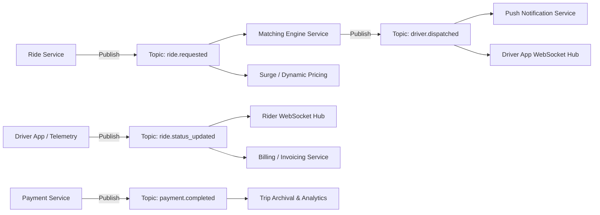

# Round 3: High-Level System Design Challenge (HLD) - Ride-Sharing Platform

## Overview
This document outlines the complete High-Level System Architecture for a global ride-sharing and driver dispatch platform designed to support **tens of millions of daily active users (DAUs)**, **hundreds of thousands of concurrent drivers**, and **millions of trips per day**.

---

## 1. System Architecture

The architecture adopts an **Event-Driven, Geo-Distributed Microservices** pattern deployed on cloud infrastructure (e.g., Kubernetes / EKS).

### Architectural Diagram

```mermaid
graph TB
    subgraph Clients["Mobile Client Layer"]
        RiderApp["Rider Mobile App (iOS / Android)"]
        DriverApp["Driver Mobile App (iOS / Android)"]
    end

    subgraph Edge["Edge & Ingress Layer"]
        DNS["Route53 / Global Accelerator"]
        CDN["CloudFront / CDN (Static Assets & Map Tiles)"]
        WAF["WAF & DDoS Protection (Cloudflare / AWS Shield)"]
        APIGateway["API Gateway & Reverse Proxy (Envoy / Kong)"]
        WSGateway["WebSocket Gateway (Netty / SocketCluster)"]
    end

    subgraph Microservices["Core Microservices Layer"]
        UserSvc["User Service<br/>(Auth, Rider Profiles, Preferences)"]
        DriverSvc["Driver Service<br/>(Onboarding, Docs, Vehicle Details)"]
        RideSvc["Ride & Dispatch Service<br/>(State Machine, Matching Engine)"]
        LocationSvc["Location Tracking Service<br/>(Geohash/H3, Driver Coordinates)"]
        PricingSvc["Pricing & Surge Engine<br/>(Dynamic Surge, Base Fare, ETA)"]
        PaymentSvc["Payment & Invoicing Service<br/>(Wallets, Cards, Receipts)"]
        NotificationSvc["Notification Service<br/>(FCM, APNs, SMS, Email)"]
    end

    subgraph Caches["Distributed Caching & In-Memory Grids"]
        RedisGeo["Redis Geospatial Cluster<br/>(Driver Real-Time Coords & Availability)"]
        RedisSession["Redis Cache Cluster<br/>(Active Ride Session, POIs, Rates)"]
    end

    subgraph Broker["Event Streaming & Message Broker"]
        Kafka["Apache Kafka Event Bus<br/>(Topics: ride-requested, driver-matched, ride-status)"]
    end

    subgraph Persistence["Storage & Database Layer"]
        UserDB[(User & Driver DB<br/>PostgreSQL Multi-AZ)]
        RideHistoryDB[(Trip History & Telemetry<br/>Apache Cassandra / ScyllaDB)]
        PaymentDB[(Payment & Ledger DB<br/>PostgreSQL ACID)]
        AnalyticsLake[(Data Lake & Warehouse<br/>Snowflake / ClickHouse)]
    end

    %% Client Connections
    RiderApp --> DNS
    DriverApp --> DNS
    DNS --> APIGateway
    DriverApp -->|Continuous GPS Telemetry (HTTP/2 or WS)| WSGateway
    RiderApp -->|Live Driver Tracking Stream| WSGateway

    %% Gateway to Services
    APIGateway --> UserSvc
    APIGateway --> DriverSvc
    APIGateway --> RideSvc
    APIGateway --> PricingSvc
    APIGateway --> PaymentSvc
    WSGateway --> LocationSvc

    %% Service to Cache & DB
    UserSvc --> UserDB
    DriverSvc --> UserDB
    PaymentSvc --> PaymentDB
    RideSvc --> RideHistoryDB
    LocationSvc --> RedisGeo
    RideSvc --> RedisSession
    PricingSvc --> RedisSession

    %% Event Broker Connections
    RideSvc -->|Publish Events| Kafka
    LocationSvc -->|Publish GPS Updates| Kafka
    Kafka -->|Consume Events| RideSvc
    Kafka -->|Consume Events| NotificationSvc
    Kafka -->|Stream Telemetry| RideHistoryDB
    Kafka -->|ETL Stream| AnalyticsLake
```

### Core Microservices Breakdown
1. **User Service:** Manages rider authentication, profile data, rating, and stored payment tokens.
2. **Driver Service:** Manages driver onboarding, vehicle verification, background checks, and active shift state.
3. **Ride & Dispatch Service:** Core state engine managing ride requests, finding candidate drivers, dispatch timers, and ride lifecycle.
4. **Location Tracking Service:** Ingests high-frequency driver GPS pings (every 3–5 seconds), performs spatial index quantization (Uber H3 / Geohash), and calculates distance metrics.
5. **Pricing & Surge Engine:** Calculates dynamic fares based on base rates, estimated traffic distance, weather, and real-time supply-demand imbalance per geospatial cell.
6. **Payment Service:** Processes credit card, digital wallet, and UPI transactions via PCI-DSS compliant payment gateways with idempotency guarantees.
7. **Notification Service:** Dispatches out-of-band alerts (Apple APNs, Google FCM, Twilio SMS) when riders or drivers background their apps.

---

## 2. REST API Communication & Protocols

| Communication Channel | Protocol | Use Case | Rationale |
|-----------------------|----------|----------|-----------|
| **Mobile App to Gateway (Transactions)** | **REST over HTTP/2 with TLS 1.3** | Booking rides, user auth, profile updates, rating, payment processing. | Stateless, cache-friendly, multiplexed over single TCP connection, ubiquitous mobile SDK support. |
| **Driver Location Ingestion** | **gRPC / WebSocket over TLS** | Continuous driver GPS location pings (every 3 seconds). | Ultra-low overhead (binary protobuf), persistent connection eliminates repeated TLS handshakes. |
| **Live Ride & Driver Tracking** | **WebSockets / Server-Sent Events (SSE)** | Streaming moving driver location to the rider's map in real time. | Low-latency duplex or push communication; eliminates battery-draining client polling. |
| **Inter-Service Communication** | **gRPC (Internal)** | Direct synchronous microservice queries (e.g., Ride Svc querying User Svc). | Sub-millisecond serialization using Protocol Buffers and HTTP/2 transport. |

---

## 3. Database Selection & Storage Strategy

| Data Domain | Selected Database | Architectural Rationale & Guarantees |
|-------------|-------------------|--------------------------------------|
| **Users & Drivers** | **PostgreSQL (Aurora Multi-AZ)** | Strong relational ACID compliance, complex relational queries (foreign keys for vehicles, documents), data consistency for user credentials and driver KYC. |
| **Ride Lifecycle & Trips History** | **Apache Cassandra / ScyllaDB** | Extremely high write throughput (millions of completed rides per day). Linear horizontal scalability. Partition key: `(city_id, year_month)`, Clustering key: `(ride_id, created_at)`. |
| **Real-Time Driver Locations** | **Redis Geospatial (`GEOADD` / `GEORADIUS`)** | In-memory key-value store with sub-millisecond geospatial indexing. Driver locations are ephemeral; durability is not required for real-time dispatch. |
| **Historical Telemetry & Routes** | **TimescaleDB / Amazon S3 Parquet** | High-volume time-series storage for GPS coordinate logs used for post-trip dispute resolution, analytics, and speed tracking. |
| **Payments & Invoices** | **PostgreSQL (Strict ACID / Ledger)** | Double-entry bookkeeping requires strict serializable isolation, zero data loss, zero dirty reads, and immutable audit logs. |

---

## 4. Caching Strategy

```
+--------------------------------------------------------------------------+
|                            CACHE ARCHITECTURE                            |
+--------------------------------------------------------------------------+
| [Layer 1: Edge CDN]        Static map tiles, assets, vehicle icons (CloudFront)
| [Layer 2: Redis Cluster]   Driver Availability & Spatial Index (H3 Grid)
| [Layer 3: Local L1 Cache]  Caffeine in-memory cache on app instances (Config/Rates)
+--------------------------------------------------------------------------+
```

1. **Driver Availability & Spatial Proximity Cache:**
   - **Engine:** Redis Geospatial Cluster (`GEOADD`, `GEOSEARCH`).
   - **Partitioning:** Partitioned by City/Geographic zone (e.g., `drivers:mumbai`, `drivers:delhi`).
   - **Heartbeat & TTL:** Each driver coordinate ping updates location and resets an in-memory key with a **15-second TTL**. If a driver loses internet connectivity or turns off GPS, they automatically expire from the available pool.

2. **Frequently Used Locations & Points of Interest (POIs):**
   - **Engine:** Redis Key-Value / ElastiCache with LRU (Least Recently Used) eviction policy.
   - **Data Cached:** Popular airports, transit hubs, tech parks, geocoded addresses.
   - **TTL:** 24 Hours. Eliminates recurring expensive external Google Maps / Mapbox Geocoding API lookups.

3. **Active Ride State Cache:**
   - **Engine:** Redis Hash (`ride:{rideId}`).
   - **Data Cached:** Current status, driver coordinates, route polyline, ETA.
   - **TTL:** 2 hours after ride completion. Guarantees sub-5ms retrieval for riders repeatedly opening the tracking view.

---

## 5. Asynchronous Messaging & Event-Driven Architecture

The platform uses **Apache Kafka** as its enterprise-grade distributed event log.

### Kafka Topic Topography



### Event Topics & Schemas
1. **`ride.requested`**
   - **Payload:** `{ rideId, riderId, pickupGeo, dropGeo, vehicleType, timestamp }`
   - **Partition Key:** `geohash_prefix` (keeps regional requests strictly ordered within the same Kafka partition).
2. **`driver.dispatched`**
   - **Payload:** `{ rideId, driverId, etaMinutes, pickupDistanceKm }`
   - **Consumers:** Notification Service dispatches push banners; WebSocket server routes notification to driver handset.
3. **`ride.status_updated`**
   - **Payload:** `{ rideId, status: "DRIVER_ASSIGNED"|"ARRIVED"|"IN_PROGRESS"|"COMPLETED"|"CANCELLED", timestamp }`
   - **Consumers:** Rider WebSocket stream, billing service, fraud detection engine.
4. **`driver.location_ping`**
   - High-throughput streaming topic (batched every 500ms) consumed by spatial indexing workers and historical route sinks.

---

## 6. Scalability: Handling Sudden Traffic Spikes

A ride-sharing platform regularly experiences massive traffic spikes (e.g., rainstorms, concerts, sports events, New Year's Eve). The system handles this through multiple resilient strategies:

### 1. Dynamic Surge Pricing (Supply & Demand Equilibrium)
- Micro-regions are divided into **Uber H3 Resolution 8 Hexagons** (~460 meters).
- If the ratio of `ride_requests / available_drivers > 2.0`, the pricing engine computes a surge multiplier (e.g., 1.5x to 2.5x).
- **Effect:** Discourages price-sensitive riders while incentivizing idle drivers from adjacent cells to move into the surge zone.

### 2. Distributed Rate Limiting (Token Bucket Algorithm)
- Enforced at the API Gateway layer (Envoy / Kong with Redis backing).
- Restricts anomalous client spam (e.g., limit each user to 5 ride booking attempts per minute).
- Protects downstream microservices from Cascading Denial of Service (DoS).

### 3. Queue-Based Load Leveling (Asynchronous Backpressure)
- Booking requests are immediately acknowledged into the **Kafka `ride.requested` topic** with an HTTP 202 Accepted / 201 Created status.
- Downstream Matching Engines consume requests at a steady, sustainable throughput. If traffic surges 10x, Kafka buffers requests reliably without database connection exhaustion.

### 4. Horizontal Pod Autoscaling (HPA) & Serverless Scaling
- Kubernetes HPA monitors CPU, memory, and **Kafka Consumer Lag**.
- When consumer lag spikes, additional worker pods scale out within 45 seconds to drain the dispatch queue.

### 5. Geo-Sharded Architecture & Regional Isolation
- Infrastructure is sharded by Geographic Metro Region (e.g., `apac-mumbai`, `apac-delhi`, `us-west-sf`).
- A localized surge (e.g., Cricket World Cup final in Mumbai) remains isolated to the Mumbai cluster, leaving services in other cities completely unaffected.

### 6. Read-Replica Pooling & Database Protection
- Relational databases use **PgBouncer** connection poolers to prevent connection exhaustion.
- Heavy reads (driver profile lookups, car details) are served from read replicas or Redis, preserving write capacity for primary databases.
